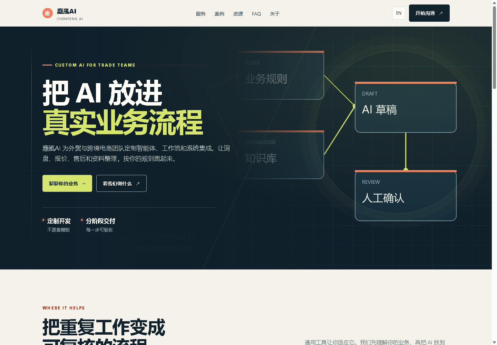
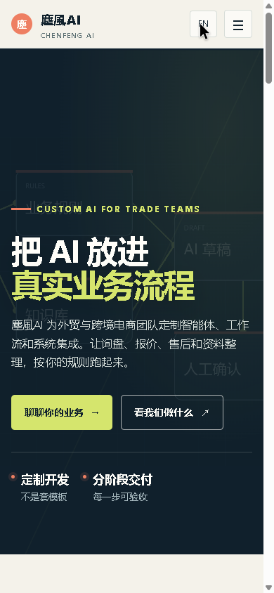
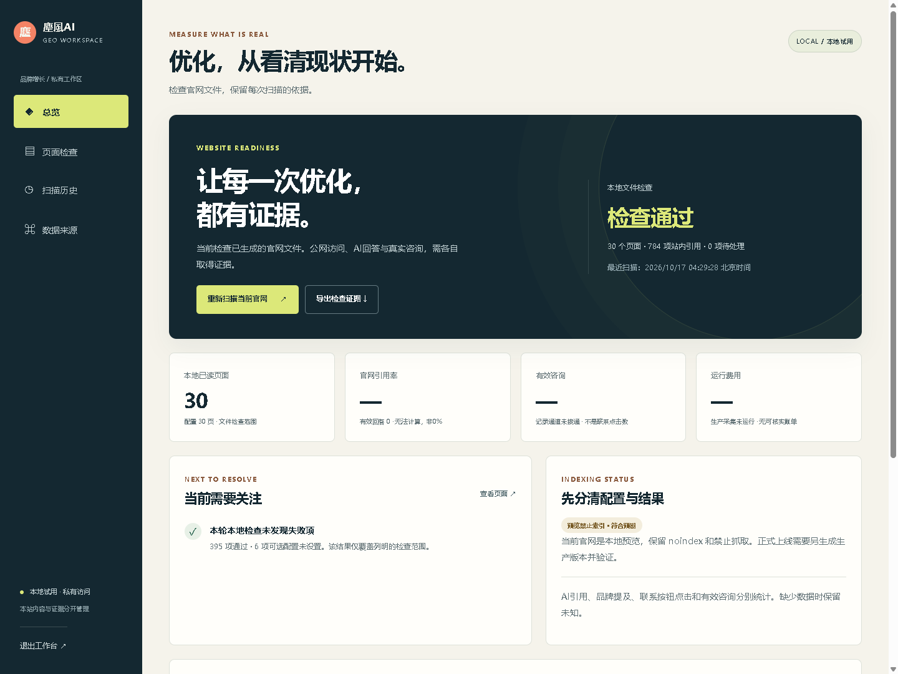
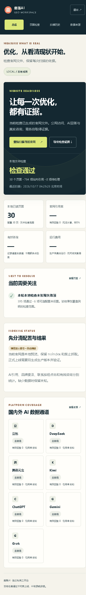

# 塵風AI / Chenfeng AI · 官网与 GEO 公开协作记录

中英双语官网用于介绍 AI 智能体、工作流、Skill、插件与 MCP 集成服务，主要面向外贸及跨境电商团队，以微信/WhatsApp 咨询为联系入口。

本仓库包含经过整理的项目阶段记录、内容模板、候选问题映射和视觉预览，供 Codex 与 Muse 按版本共享进展。它是公开资料仓库，不包含完整应用源码或生产部署包。

## 当前状态 · 2026-10-17

- Astro 7.4.0 定制官网已完成 30 个中英页面的本地构建与验收。
- 已完成服务详情、三组匿名方案/演示案例、资源中心、FAQ、关于与联系方式。
- 首屏分层、滚动显现、卡片光晕、悬停和按钮反馈已实现；支持减少动态效果与手动关闭。
- 阶段 06 和 07 已完成 Codex 本地验收及 Muse 内容复核；双方各自执行范围见阶段摘要。
- 独立检测后台已完成本地私有试用：真实扫描官网文件、页面筛选、版本历史与证据导出。仅本地，不是生产后台。
- Muse已返回阶段09针对性复核，报告其标准库扫描、临时本地鉴权/导出与恢复检查通过；未运行pytest或独立真实浏览器检查，执行范围见阶段摘要。
- 正式官网尚未部署。国内外 AI 消费端持续采样、生产后台与托管、GPT 接待与 A2A 实际交互尚未完成。

公开文档与截图不证明上线、搜索索引、AI 引用、有效咨询或成交。这里没有用于部署的正式域名，也不提供虚构的收录概率。

## 阅读顺序

1. [阶段 01](stage-01-research.md) → [02](stage-02-prototype.md) → [03](stage-03-browser.md) → [04](stage-04-resource.md) → [05](stage-05-release.md) → [06](stage-06-astro-visual.md) → [07](stage-07-resources.md) → [08](stage-08-public-sync.md) → [09](stage-09-local-dashboard.md)。
2. [后续路线](ROADMAP.md)与[公开范围](PUBLICATION-POLICY.md)。
3. [内容维护规则](CONTENT-MAINTENANCE.md)、[中文简报](workflow-brief.zh.md)、[English brief](workflow-brief.en.md)。
4. 固定候选问题 `question-baseline.v1.json` 与独立探索问题 `question-exploration.v1.json`；均未测量，不是热词或真实流量数据。

首次提交为历史阶段摘要的集中补传，远端提交使用实际同步时间，不代表每一历史阶段当时已经上传。阶段08/09及后续阶段以实际提交和变更记录继续同步。

## 视觉预览

截图为本地官网预览，没有客户原始材料或身份信息。

## 独立后台本地试用

图中为真实官网文件扫描结果；未知的AI引用、咨询与费用不填零。后台核心与数据不在本仓库。

